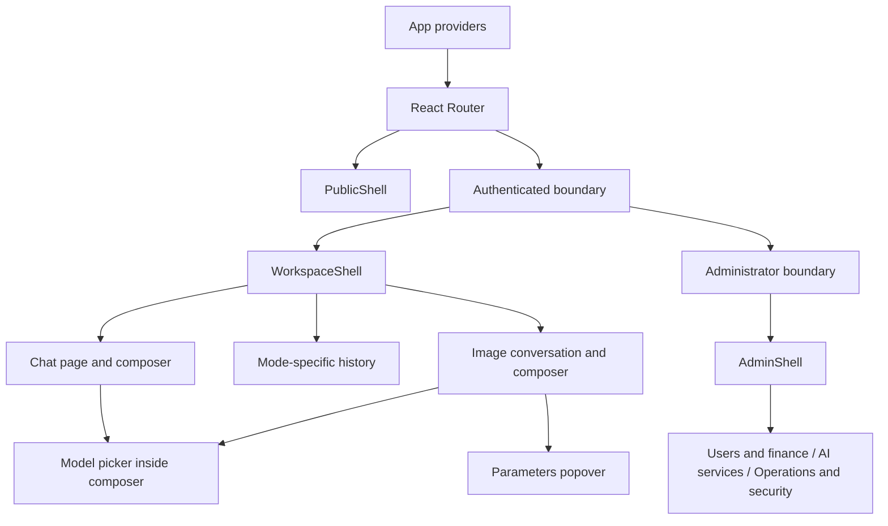

# React UI migration

## Scope and baseline

The migration starts from `main` commit `c28be7fe16ca911f2b9443c27ce887f14f96b5d8` (v0.1.0). The user authorized sequential implementation of PR-0 through PR-7 on 2026-10-24, including advancing after a milestone passes without another confirmation. Work stays off `main`; the final production change is a separate pull request. This authorization does not permit rewriting backend business rules.

Keep Gin, PostgreSQL, Redis, migrations, OpenAPI, SSE, task execution, image storage, credit settlement and Compose. Continue producing `backend/web/dist` for Go's production embed. Keep the `app` mount ID, existing URLs, same-origin assets and CSP. No SSR or separate production frontend server is introduced.

The supplied `Lumi-React-UI-Design-Package/` is a visual reference. Its models, balances, charts, task results and administrative actions are demonstrations. Its inline handlers and synthetic responses do not enter production code.

## Repository audit and ownership

| Existing code                                                                              | Decision                                                                | Owner after migration                                     |
| ------------------------------------------------------------------------------------------ | ----------------------------------------------------------------------- | --------------------------------------------------------- |
| `frontend/src/api/transport.ts`                                                            | Reuse request/error/header behavior                                     | Framework-independent transport                           |
| `api/schema.d.ts`, `contracts.ts`, `*-contracts.ts`                                        | Preserve generated types and runtime validation                         | Shared API contracts                                      |
| `api/accounts.ts`, `catalog.ts`, `chat.ts`, `images.ts`, `credits.ts`, `operations.ts`     | Preserve endpoints, payloads and parsers; adapt session access          | Shared API clients                                        |
| `api/protected.ts`                                                                         | Remove its direct Pinia dependency                                      | Independent session port and authorized-client factory    |
| `features/chat/markdown.ts`, `messages.ts`                                                 | Reuse safe rendering/block partitioning and message helpers             | Shared domain logic with React rendering                  |
| `features/accounts/utils.ts`                                                               | Reuse validators and date filters; cover `/create` login return         | Shared utilities                                          |
| `features/accounts/time.ts`, `features/images/actions.ts`, `features/credits/resources.ts` | Separate pure operations from Vue lifecycle                             | React hooks and pure helpers                              |
| Seven stores: auth, chat, images, models, site, system, theme                              | Replace Pinia ownership                                                 | Session service, TanStack Query and scoped Zustand stores |
| Vue pages, shell, components, router and Reka primitives                                   | Rebuild against the reference and feature matrix                        | React, Router, shadcn/Radix and lucide-react              |
| `i18n/*.ts`                                                                                | Reuse keys and wording; test `{name}` interpolation and locale behavior | react-i18next                                             |
| `backend/web/`, Dockerfile, Makefile, deployment and release workflows                     | Preserve integration contracts                                          | Existing Go/build infrastructure                          |

`WorkspacePage.vue` is not registered by the current router. `admin/OperationsPage.vue` serves five different routes; these become separate React pages. API CSV/blob operations also need browser lifecycle and identity checks, despite being independent of Vue.

## Target source layout

```text
frontend/src/
  react/
    main.tsx
    app/{App,providers,router}.tsx
    app/session-scope.ts
    layouts/{PublicShell,WorkspaceShell,AdminShell}.tsx
    components/ui/
    components/shared/{AccountMenu,ModelPicker,CreditBadge,MobileDrawer,RuntimeBanner}.tsx
    features/auth/
    features/accounts/
    features/catalog/
    features/chat/{queries,stream-controller,drafts}.ts
    features/chat/components/
    features/images/{queries,task-subscriptions,drafts}.ts
    features/images/components/
    features/credits/
    features/admin/
    pages/{Auth,ResetPassword,Chat,ChatHistory,Image,ImageGallery,Credits,Profile,Security,Legal,NotFound}Page.tsx
    pages/admin/{Dashboard,Users,UserDetail,CreditLedger,RedeemCodes,Upstreams,Models}Page.tsx
    pages/admin/{ChatSettings,ImageTasks,ImageSettings,Pricing,Conversations,Announcements}Page.tsx
    pages/admin/{OperationsSettings,Settings,System,Audit}Page.tsx
    stores/{session,theme,workspace-ui}.ts
    i18n/
    styles/{tokens,globals}.css
  api/
    session.ts
    protected.ts
    transport.ts
    schema.d.ts
    existing endpoint and contract modules
  features/
    existing reusable framework-independent helpers and contract tests
  i18n/
    existing shared Chinese and English message resources
```

The permanent `src/react/` boundary lets the candidate coexist with Vue without moving all old sources or introducing filename collisions. PR-1 supplies a separate Vite candidate mode using the same HTML mount and a selected entry module. The normal production entry remains Vue through PR-6. PR-7 selects the React entry after full acceptance and removes only unreferenced legacy code and dependencies. Shared modules remain outside either UI tree.



## Data and session architecture

- TanStack Query owns server snapshots: models, configuration, histories, tasks, credits, ledger and administrative lists. Cache keys include the authenticated user and every filter/cursor dimension. Mutations do not automatically repeat business writes.
- Zustand owns UI state, theme, mode selections, drafts and pending submission metadata. Draft keys include user, mode and conversation; chat and image state never share an unqualified `new` draft.
- Session behavior is framework-independent and instance-based: memory-only token, initialization/refresh single flight, Web Locks coordination, generation fencing, and waiting for server logout. An explicit legacy adapter and a React adapter connect UI state to the same session contract. The transport imports neither framework.
- Stream controllers own readers, abort controllers, event IDs, frame batching and subscription cleanup. They reconcile durable server data without creating a second authoritative copy of complete histories in Zustand.
- Session changes abort private queries, streams, quotes and uploads, clear private caches/drafts/object URLs, and reject late completions from previous identities. Disconnecting an image subscription does not call the cancel endpoint.

## Visual and interaction contract

Use the reference's light background, restrained purple accent, system fonts, approximately 260px desktop sidebar, 60–68px header and 800–840px conversation column. Implement both light and dark tokens, system preference, reduced motion and visible keyboard focus. No remote fonts are necessary.

Both creation modes remain conversations. History switches with the mode; drafts and last-opened conversations are independent. Composer toolbars contain mode and model selection. Image quality, ratio, size and count live in a Radix popover with an outside summary and a real server quote. There is no canvas editor or frontend settlement calculation.

The sidebar account popover is anchored, collision-aware and no wider than the available sidebar/viewport. Mobile navigation uses a focus-managed drawer, closes on navigation and supports Escape. The final 320px and 390px layouts must be remeasured; the supplied mobile concept image has visible cropping and is not acceptance evidence.

AdminShell has an overview plus users/finance, AI services and operations/security groups. Grouping does not remove any existing route or operation. The prototype's growth percentages and system-health indicator are shown only where existing APIs support the displayed claim; no inferred business metrics are fabricated.

## Milestones and branch policy

`codex/react-ui` is the isolated integration branch. Each milestone has its own `codex/react-ui-pr-N` branch and PR targeting the integration branch. Advancing requires successful applicable checks; no automatic merge into `main` or production deployment occurs. PR-7 is the final release proposal targeting `main`.

| Milestone | Changes                                                                                                           | Gate                                                                                       |
| --------- | ----------------------------------------------------------------------------------------------------------------- | ------------------------------------------------------------------------------------------ |
| PR-0      | Audit, compatibility matrix, source plan, baseline, test plan, valid reference documents                          | Documentation/prototype checks and existing baseline remain valid                          |
| PR-1      | React toolchain, strict TSX, Tailwind tokens, Query/Zustand/i18n, independent session adapter, candidate build/CI | Both builds, legacy regressions and new adapter/toolchain tests                            |
| PR-2      | Authentication, reset, theme, guards, workspace and admin shells, mobile drawer                                   | Direct links, session isolation, menus, focus and responsive authentication                |
| PR-3      | Complete chat, history, Markdown, vision, SSE, stop/edit/regenerate/export and virtualization                     | Existing chat assertions plus browser reconnect, refresh and IME cases                     |
| PR-4      | Image conversations, parameters, quote, editing/uploads, tasks and gallery                                        | Unknown-response replay, exact settlement display, cancel/refund and protected files       |
| PR-5      | Credits, redemption, ledger/statistics, profile/avatar, preferences, devices and account deletion                 | Credit idempotency and account/security regressions                                        |
| PR-6      | Every administrative route and action                                                                             | Full compatibility matrix; smaller sequential PRs by navigation group if needed            |
| PR-7      | Full candidate acceptance, entry switch, legacy dependency removal, full post-cleanup acceptance                  | Chrome desktop/mobile, Go integration, Docker embed/Compose and existing performance gates |

Dependency order: PR-0 → PR-1 → PR-2 → PR-3 → PR-4 → PR-5 → PR-6 → PR-7. Shared credit balance and quote queries are available for PR-4; the complete credits page follows in PR-5. Large milestones are split into bounded sub-PRs without merging incomplete production defaults.

Every stage runs typecheck, lint, unit tests, build and relevant browser tests. Legacy full E2E continues against the legacy build while candidate tests grow with completed features. Candidate and legacy builds use separate jobs or sequential writes to `backend/web/dist`; they never overwrite each other's assets during tests. Existing assertions are preserved when selectors change.

## Planned file changes by phase

| Phase | Added/changed paths                                                                                                                                    | Explicit boundary                                                       |
| ----- | ------------------------------------------------------------------------------------------------------------------------------------------------------ | ----------------------------------------------------------------------- |
| 0     | `docs/REACT_UI_*.md`, supplied design package, `docs/DECISIONS.md`                                                                                     | No production source or dependency changes                              |
| 1     | frontend manifests/lockfile, TS/Vite/ESLint configs, `src/api/session.ts`, authorized client and legacy adapter, `src/react/` foundation, candidate CI | Existing Go API, SQL, Compose and production default remain intact      |
| 2–5   | React feature/page modules and migrated behavior tests                                                                                                 | Shared protocol parsers remain authoritative                            |
| 6     | React admin pages, grouped navigation and administrative regression coverage                                                                           | No new business permissions or settlement logic                         |
| 7     | Production entry/scripts/docs and unreferenced Vue dependency/source removal                                                                           | Cleanup follows acceptance and requires another complete acceptance run |

Exact dependency versions and peer compatibility are resolved in PR-1, pinned without ranges and recorded in DECISIONS plus `pnpm-lock.yaml`. Preserve current Vite 8, TypeScript strict and Tailwind 4 unless a demonstrated incompatibility requires an explicit decision. Prefer existing validators and Markdown libraries to unnecessary additional frameworks.

No SQL migration or OpenAPI change is required by PR-0. Frontend-only milestones mark those template items not applicable and still verify generated types; they do not add empty migrations or alter API fields to fit the visual prototype.
